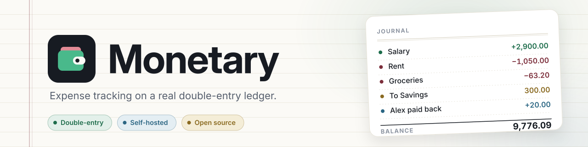
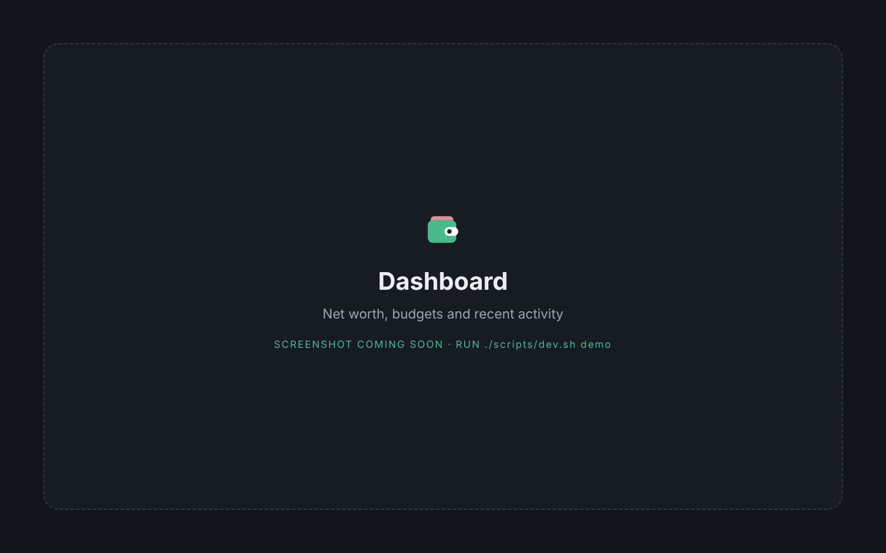
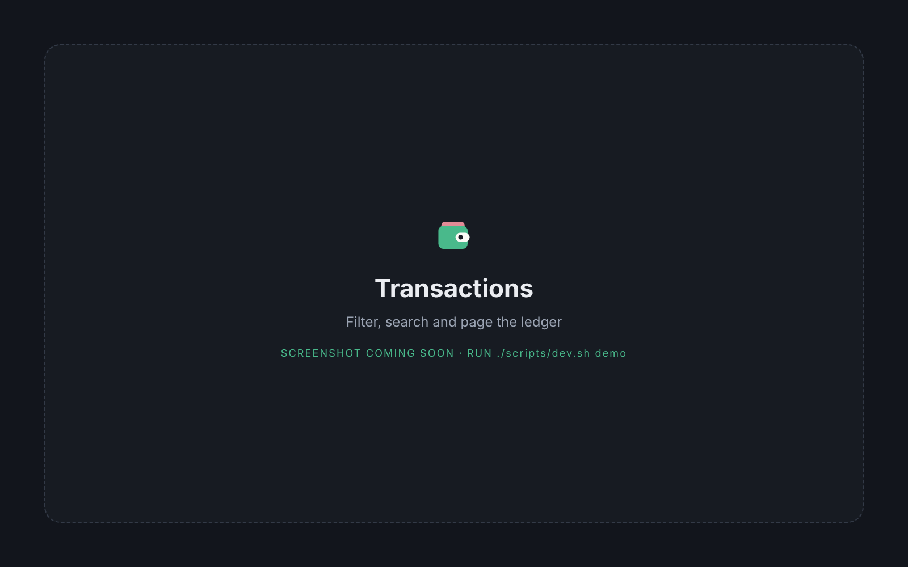
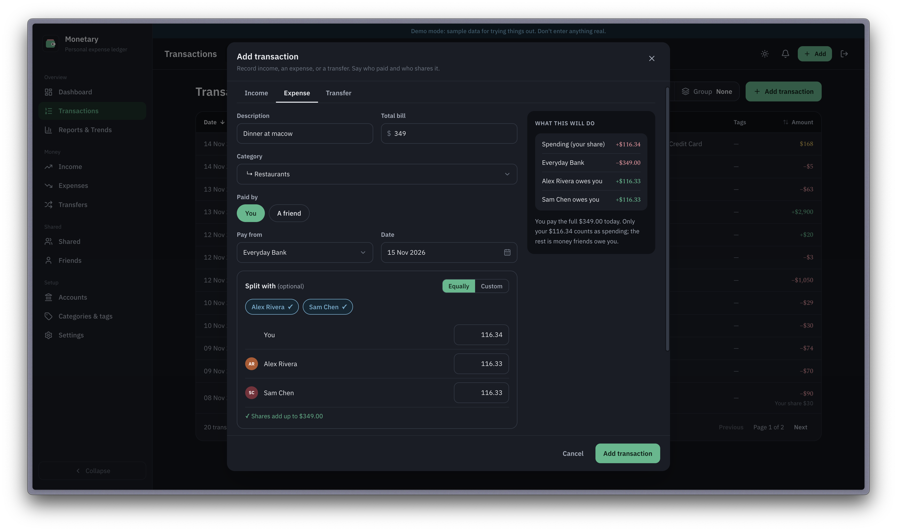
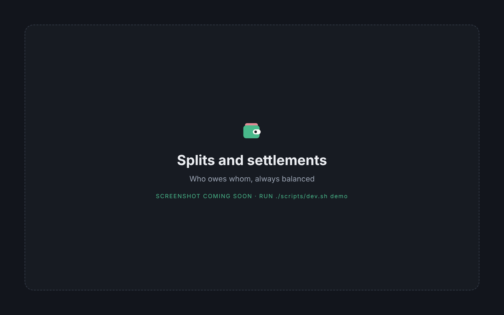
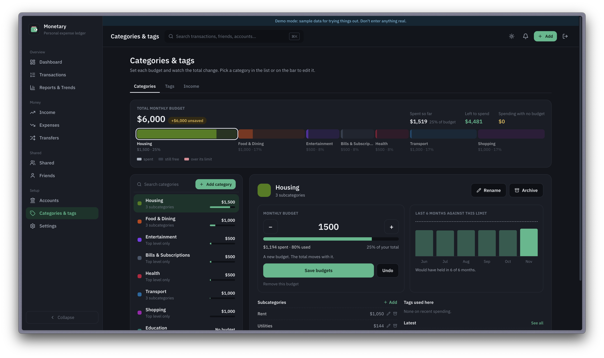
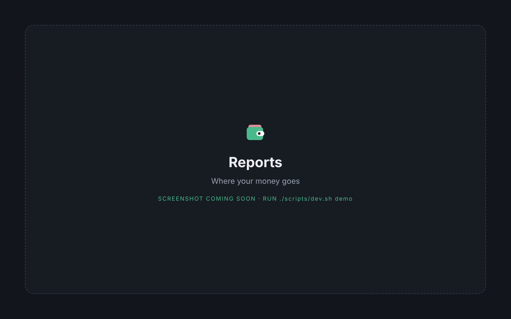
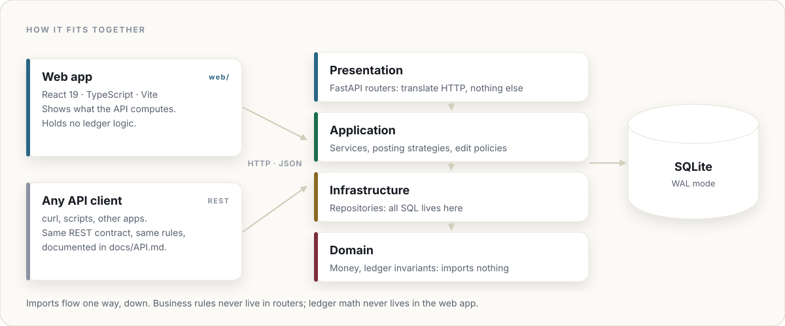
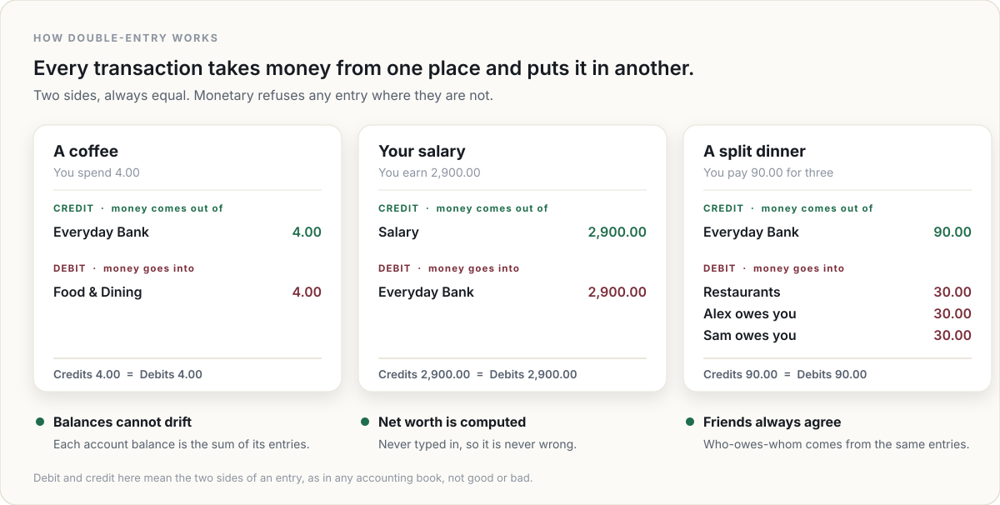

<p align="center">
  <picture>
    <source media="(prefers-color-scheme: dark)" srcset="docs/images/branding/banner-dark.svg">
    
  </picture>
</p>

<p align="center">
  <a href="https://github.com/Neutrino79/duevia-ledger/actions/workflows/ci.yml"></a>
  <a href="LICENSE"></a>
  
  
  <a href="CONTRIBUTING.md"></a>
</p>

<p align="center">
  <b>Track expenses, split bills, set budgets, and know where your money went.</b><br>
  Every transaction is a balanced double-entry journal, so the numbers always add up.
</p>

<p align="center">
  <a href="#try-the-demo-in-60-seconds">Demo</a> ·
  <a href="#features">Features</a> ·
  <a href="#screenshots">Screenshots</a> ·
  <a href="#quick-start">Quick start</a> ·
  <a href="#how-it-works">How it works</a> ·
  <a href="#configuration">Configuration</a> ·
  <a href="#contributing">Contributing</a> ·
  <a href="#license">License</a>
</p>

## Try the demo in 60 seconds

No account, no setup, no data of yours:

```bash
./scripts/dev.sh demo        # API on :8000, web app on :5173, with a year of sample data
```

Open <http://localhost:5173> and press **Start the demo**. In VS Code, run the task
**Dev: demo (reset demo DB)**. Details: [Demo mode](#demo-mode).

## Features

- **Real double-entry ledger.** Expenses, income, refunds and transfers post balanced journal entries
  (`DIRECT` or `STRICT` posting). Balances, net worth and reports can never disagree.
- **Accounts and credit cards** with opening balances and live balances.
- **Categories, tags and income sources**, with sensible defaults seeded at first run.
- **Budgets** that track spending against what you planned.
- **Split bills with friends** and settle up; friend balances come straight from the ledger.
- **Reports** on where your money goes, with filtering and paging done by the API.
- **Self-hosted and private.** Single owner, bcrypt password hashing, rate-limited login and reset, SQLite file.
- **Thin web app.** `web/` shows what the API computes; there is no ledger math in the browser.

## Screenshots

Captured in [demo mode](#demo-mode) (sample data, dark theme). Click an image for the full size.

<table>
  <tr>
    <td width="50%"><a href="docs/images/screenshots/dashboard.png"></a><br><sub><b>Dashboard.</b> Income, spending pace and where the money went.</sub></td>
    <td width="50%"><a href="docs/images/screenshots/transactions.png"></a><br><sub><b>Transactions.</b> Search, filter and page the whole ledger.</sub></td>
  </tr>
  <tr>
    <td width="50%"><a href="docs/images/screenshots/add-transaction.png"></a><br><sub><b>Add a transaction.</b> Expenses, income, transfers and splits.</sub></td>
    <td width="50%"><a href="docs/images/screenshots/splits.png"></a><br><sub><b>Shared.</b> Who owes what, with one-click settle up.</sub></td>
  </tr>
  <tr>
    <td width="50%"><a href="docs/images/screenshots/budgets.png"></a><br><sub><b>Budgets.</b> Spending against what you planned.</sub></td>
    <td width="50%"><a href="docs/images/screenshots/reports.png"></a><br><sub><b>Reports and trends.</b> Where your money goes over time.</sub></td>
  </tr>
</table>

## How it works

<p align="center">
  <picture>
    <source media="(prefers-color-scheme: dark)" srcset="docs/images/architecture-dark.svg">
    
  </picture>
</p>

<p align="center">
  <picture>
    <source media="(prefers-color-scheme: dark)" srcset="docs/images/double-entry-dark.svg">
    
  </picture>
</p>

More in [`docs/ARCHITECTURE.md`](docs/ARCHITECTURE.md) and the endpoint reference [`docs/API.md`](docs/API.md).

**Stack:** Python 3.11+, FastAPI, SQLite (WAL) · React 19, TypeScript, Vite, Tailwind CSS v4.

## Quick start

Requirements: Python 3.11+ with `pip`, and Node.js 22 with npm (web app only).

**One command** (macOS/Linux, or Git Bash/WSL on Windows):

```bash
./scripts/dev.sh            # opens the API (:8000) and the web app (:5173) in two separate terminal windows
./scripts/dev.sh inline     # same, but both in the current terminal with [api]/[web] prefixes; Ctrl+C stops both
./scripts/dev.sh demo       # inline, in DEMO MODE: fresh sample data, no setup or account (--keep keeps edits)
./scripts/dev.sh backend    # only the API
./scripts/dev.sh web        # only the web app
```

The default opens macOS Terminal (or iTerm when you run it from there) or, on Linux, gnome-terminal / konsole /
xterm; where no terminal window can be opened (SSH, no display) it falls back to `inline`. Stop each server with
Ctrl+C in its own window. On first run it creates `.venv`, installs backend and web dependencies and creates
`web/.env.local`; later runs reinstall only when `backend/requirements*.txt` or `web/package-lock.json` change.
Override ports with `BACKEND_PORT` / `WEB_PORT`.

**In VS Code**, run the task **Dev: start API + web** (`Cmd/Ctrl+Shift+P` → *Tasks: Run Task*) instead: it opens
the two servers in two side-by-side *integrated* terminals (a script cannot open tabs inside VS Code itself).

Prefer to do it by hand? Same thing, step by step:

```bash
# 1. Backend -> http://localhost:8000
python3 -m venv .venv && source .venv/bin/activate        # Windows: py -m venv .venv; .venv\Scripts\Activate.ps1
python -m pip install -r backend/requirements.txt
export MONETARY_ENV=development MONETARY_CORS_ORIGINS=http://localhost:5173
cd backend
python -m uvicorn monetary.presentation.api.app:app --reload --port 8000

# 2. Web app -> http://localhost:5173   (second terminal, from the repo root)
cd web
npm ci
cp .env.example .env.local        # VITE_API_BASE_URL defaults to http://localhost:8000/api/v0.5
npm run dev
```

The first visit shows a one-time setup screen that creates the single owner and seeds the default
categories and income sources. The same can be done over HTTP:

```bash
curl -X POST http://localhost:8000/api/v0.5/setup/init -H "Content-Type: application/json" -d '{
  "name": "You", "email": "you@example.com", "currency": "INR", "timezone": "Asia/Kolkata",
  "password": "at least 8 characters", "security_question_id": 1, "security_answer": "Whiskers"}'
```

Useful URLs: health check `http://localhost:8000/health` (also verifies DB connectivity); Swagger UI
`http://localhost:8000/docs` and `/openapi.json` (development only by default). Full endpoint map, auth
flow and error contract: [`docs/API.md`](docs/API.md).

## Demo mode

Try the app with sample data, with no setup and no account.

**Start it** (any of these):

- Terminal: `./scripts/dev.sh demo`
- VS Code: `Ctrl/Cmd+Shift+P` → **Tasks: Run Task** → **Dev: demo (reset demo DB)**. Like
  **Dev: start API + web**, it opens the API and the web app in two split terminals.

Then open <http://localhost:5173>. In demo mode the sign-in page is just a welcome message and a **Start the
demo** button (there is no email/password form). You land on a dashboard with four accounts, a full year of
transactions, two friends, splits and settlements; a banner at the top reminds you it is demo data.

**Fresh or kept?** The sample data lives in its own file, `~/.monetary_0.5/demo.db`, never in your real
`monetary.db`.

| You run | What happens to `demo.db` |
|---|---|
| `./scripts/dev.sh demo` (task **Dev: demo (reset demo DB)**) | Rebuilt from scratch on every start, so the data is clean and the dates are relative to *today* |
| `./scripts/dev.sh demo --keep` (task **Dev: demo (keep demo DB)**) | Reused if it exists (created on the first run), so your edits survive restarts |

Without `dev.sh` (for example `uvicorn` or Docker), set `MONETARY_DEMO_MODE=true` yourself. The sample
ledger is created the first time the server starts and **reused afterwards**; add `MONETARY_DEMO_RESET=true`
to rebuild it at every start, or delete `demo.db` to reset it by hand.

**How it works and what it protects.** The server generates the sample ledger through its normal services
(no database file is committed). `POST /auth/demo` signs you in without a password and exists only in demo
mode. Password changes are disabled. A reset only ever deletes a demo database: if the file belongs to a real
owner, the server refuses to start instead. Never use demo mode with real data, or on a public server you
care about, because anyone who can reach it can open the sample ledger.

## Repository layout

```text
backend/                   Python backend: everything needed to run and test the API
  monetary/                  The package
    config.py                  Product identity and every environment variable (single source of truth)
    seed_defaults.json         Default categories / income sources created at first-run setup
    domain/                    Money, ledger invariants, enums, exceptions, hashing -- no DB or HTTP
    application/               Services (use cases), posting strategies, edit policies
    infrastructure/            SQLite schema + connection, repositories, rate limiter
    presentation/api/          FastAPI app, routers, request/response schemas, error handling
  tests/                     unit/ (pure), service/ (application, real temp SQLite), infrastructure/ (repositories, DB),
                             api/ (HTTP TestClient), deployment/ (config in a subprocess), tooling/ (scripts/), support/
  pyproject.toml             ruff, pytest and coverage configuration
  requirements.txt  requirements-dev.txt
  .env.example               Backend configuration template
web/                       Web app -- a self-contained npm project with its own README and tooling
docs/                      API reference, architecture, SQLite schema (archive/ holds historical records)
scripts/dev.sh             One-command local development (API + web)
scripts/check.sh           One-command backend validation
scripts/commit_lint.py     Checks branch names, commit messages, PR titles and descriptions
.github/                   Workflows (CI, PR conventions, release), release-please config, Dependabot,
                           PR/issue templates, CODEOWNERS
.devcontainer/             VS Code / Codespaces container definition
CONTRIBUTING.md            Branch, commit, PR and code conventions (enforced by hooks and CI)
AGENTS.md  CLAUDE.md       Rules for AI coding agents (Copilot/Cursor pointers live in .github/ and .cursor/)
.vscode/                   Shared VS Code tasks and extension recommendations
.pre-commit-config.yaml    Git hooks (see Developer tooling)
.editorconfig  .gitattributes  .gitmessage  .secrets.baseline  CHANGELOG.md
```

Dependencies point one way: `presentation → application → infrastructure → domain`
(`application` also uses `infrastructure.repositories`; `domain` imports nothing from the project).
Routers translate HTTP to service calls and map results to response schemas; business rules live in
`application/` and `domain/`; all SQL lives in `infrastructure/`. More in
[`docs/ARCHITECTURE.md`](docs/ARCHITECTURE.md).

## Configuration

The backend is configured only through environment variables (defined in `backend/monetary/config.py`;
template in [`backend/.env.example`](backend/.env.example) -- the app does not load that file itself).

| Variable | Default | Purpose |
|---|---|---|
| `MONETARY_ENV` | `production` | `production` or `development`. Production hides API docs and sends HSTS + security headers |
| `MONETARY_CORS_ORIGINS` | *(empty -- no origins)* | Comma-separated browser origins allowed to call the API; `*` allows all but disables credentials |
| `MONETARY_DB_PATH` | `~/.monetary_0.5/monetary.db` | SQLite file path |
| `MONETARY_DEMO_MODE` | `false` | `true` serves a generated sample ledger from a separate `demo.db` and adds a no-credentials `POST /auth/demo`; see [Demo mode](#demo-mode) |
| `MONETARY_DEMO_RESET` | `false` | With demo mode on, `true` rebuilds the sample ledger at every start (only ever deletes a demo database) |
| `MONETARY_ENABLE_DOCS` | *(follows `MONETARY_ENV`)* | `true`/`false` forces `/docs`, `/redoc`, `/openapi.json` on or off |
| `MONETARY_APP_NAME` | `Monetary` | Product name served by `GET /meta` and shown by the web app |
| `MONETARY_APP_TAGLINE` | `Personal expense ledger` | Tagline served by `GET /meta` |
| `MONETARY_SEED_DEFAULTS_PATH` | bundled `backend/monetary/seed_defaults.json` | Replace the default categories / income sources |

The web app's own settings (`VITE_*`) are documented in [`web/.env.example`](web/.env.example).

## Database

SQLite in WAL mode. The schema is created automatically on first connection by
`backend/monetary/infrastructure/db.py` (reference copy: [`docs/LIVE_SCHEMA.sql`](docs/LIVE_SCHEMA.sql)), and the
first `POST /setup/init` seeds the defaults.

> **Schema versions.** Each database stores its schema version and is upgraded by numbered migrations
> (`backend/monetary/infrastructure/migrations.py`) when it is opened; a database from an earlier release is
> adopted as-is. The default location is `~/.monetary_0.5/monetary.db`. Back up the file before upgrading anything
> you care about.

## Testing and checks

```bash
# Backend (venv active, dev tools: python -m pip install -r backend/requirements-dev.txt)
./scripts/check.sh                  # compile check + app import + full suite with coverage
./scripts/check.sh fast             # skip the slower subprocess-based config tests
./scripts/check.sh live             # also boots a real server and curls /health

# Backend, directly (from backend/)
python -m pytest                    # unit + service + infrastructure + api + deployment + tooling tests
python -m pytest -m unit            # or one kind: unit|service|infrastructure|api|config|tooling
ruff check .                        # lint (unused/undefined names); pre-commit also lints scripts/

# Web app (from web/)
npm run typecheck                   # tsc -b --noEmit
npm run lint                        # oxlint
npm test                            # unit + UI tests with a stubbed network
npm run build                       # type-check + production bundle into dist/
npm run test:integration            # real React app -> real uvicorn -> temp SQLite (needs the backend's pip deps)
```

CI runs the same commands on every push to `main` and every pull request (see Developer tooling).

## Developer tooling

- **Git hooks** ([pre-commit](https://pre-commit.com)): after `python -m pip install -r backend/requirements-dev.txt`
  and `npm ci` in `web/`, run `pre-commit install` once (it installs the pre-commit, commit-msg and pre-push
  hooks) and `git config commit.template .gitmessage`. Then every commit runs YAML/JSON validation, merge-marker,
  private-key and secret detection (`detect-secrets`), a large-file guard, a no-commits-to-`main` guard, `ruff`
  and `oxlint`; every commit **message** is checked against Conventional Commits, and every **push** checks the
  branch name. Run them on demand with `pre-commit run --all-files`.
- **CI** ([`.github/workflows/`](.github/workflows)): `CI` (hooks, tests on Python 3.11/3.12/3.13 with a 95%
  coverage gate, web checks, `pip-audit`/`npm audit`, and a single required `CI passed` check), `PR conventions`
  (branch, title, description, commits) and `Release` (release-please). Actions are pinned to commit SHAs.
- **Dev servers**: `./scripts/dev.sh` and the VS Code tasks in `.vscode/tasks.json` (see Quick start);
  `.vscode/extensions.json` recommends the Python, Ruff, Oxc and EditorConfig extensions.
- **Editor settings**: [`.editorconfig`](.editorconfig) sets UTF-8, LF line endings, a final newline and
  indentation (4 spaces for Python, 2 elsewhere); most editors honour it automatically.
- **Dependency updates**: Dependabot opens grouped weekly PRs for pip (`/backend`), npm (`/web`) and GitHub Actions.

## Production notes

- **TLS and proxy**: run behind a TLS-terminating reverse proxy; start uvicorn with `--proxy-headers` so the
  rate limiter sees real client IPs.
- **CORS**: set `MONETARY_CORS_ORIGINS` to the web app's origin. Unset blocks every browser origin.
- **Rate limiting** is in-process (login, security-question, password-reset): fine for one instance;
  with several instances also rate-limit at the edge.
- **SQLite** suits a single instance. Moving to a server database would only change
  `backend/monetary/infrastructure/` (`db.py`, `repositories.py`, `transaction_queries.py`).
- **Web app**: a static bundle (`npm run build` → `web/dist/`); set `VITE_API_BASE_URL` at build time.
  The repo carries SPA-rewrite files for Vercel (`vercel.json`) and Netlify-style hosts
  (`public/_redirects`). There is no Dockerfile or deployment pipeline in this repository.

## Contributing

Contributions are welcome: bug reports, fixes, docs, tests and features. Start with
**[CONTRIBUTING.md](CONTRIBUTING.md)**; the short version:

1. **Find or open an issue** to discuss anything bigger than a small fix.
2. **Branch** as `<type>/<kebab-case>` (`feat/add-budget-alerts`) and make small commits in
   [Conventional Commits](https://www.conventionalcommits.org/) form (`fix(api): handle empty budgets`), with a
   body explaining *why* for `feat`/`fix`/`perf`/`refactor`.
3. **Check your work**: `./scripts/check.sh` (keep backend coverage at 95% or above), and for web changes
   `npm run typecheck && npm run lint && npm test && npm run build` in `web/`. Run `pre-commit run --all-files`.
4. **Open a PR** whose title uses the same commit format (PRs are squash-merged) and whose description follows the
   [PR template](.github/pull_request_template.md): Summary, Changes, Testing, Risk and rollout.

Layering rules: routers only translate HTTP, business rules live in `application/` and `domain/`, all SQL lives in
`infrastructure/`, and the web app holds no ledger logic. Changing the API contract means updating
`web/src/lib/api/` and [`docs/API.md`](docs/API.md) in the same PR.

Contributions are accepted under the project's Apache-2.0 license; sign your commits off with
`git commit -s` (see [CONTRIBUTING.md](CONTRIBUTING.md#8-license-and-sign-off)). Please follow the
[Code of Conduct](CODE_OF_CONDUCT.md) and report
vulnerabilities privately as described in [SECURITY.md](SECURITY.md).

**AI coding agents** must also follow [AGENTS.md](AGENTS.md): no AI attribution in commits or PRs, no commits to
`main`, no bypassing hooks.

Brand assets (logo, banners, colors) live in [`docs/images/branding/`](docs/images/branding/README.md).

## License

Licensed under the [Apache License, Version 2.0](LICENSE). Copyright 2026 Atharv Hiremath. See
[NOTICE](NOTICE) for attribution. The name "Monetary" is not licensed for use as a trademark.
