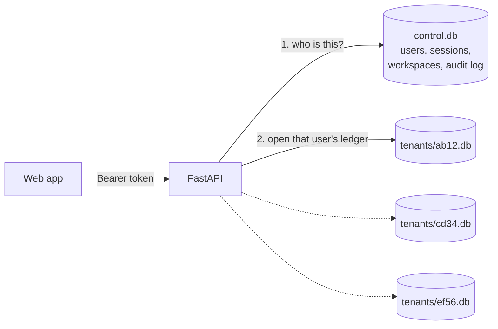
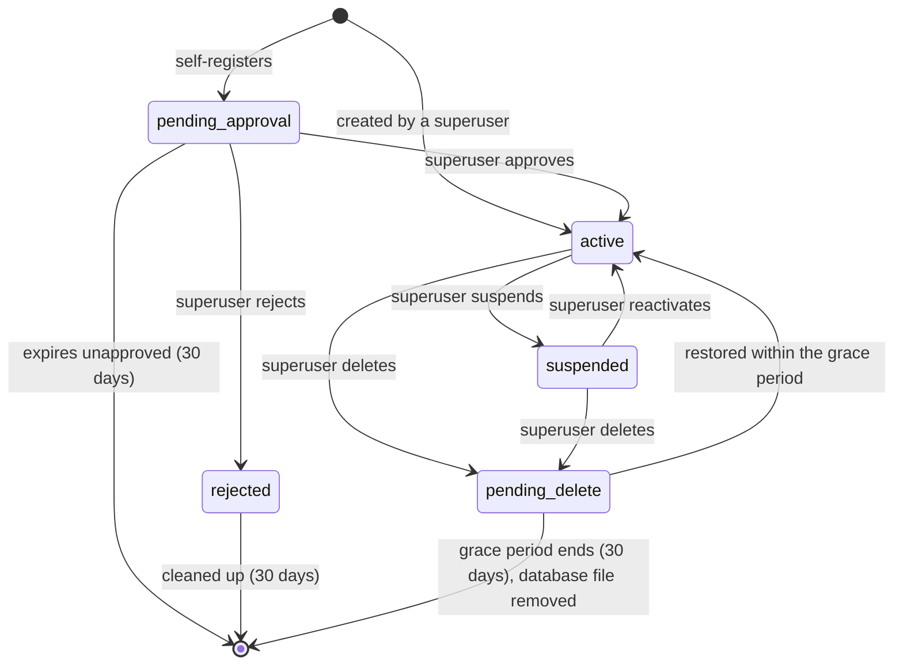

# Multi-tenant design: one database per user

Status: **implemented** on the `feat/multi-tenant` integration branch (see [section 14](#14-implementation-plan)).
The authoritative control schema is [`CONTROL_SCHEMA.sql`](CONTROL_SCHEMA.sql); the SQL below is a summary.

## 1. Goal and scope

Today Monetary is a single-owner application: one SQLite file, one owner, one login. The goal is to turn it into a
**multi-tenant hosted service** (with free self-hosting kept) where many people each get a private ledger, and a
**superuser** manages accounts by hand.

In scope:

- A **control database** for accounts, logins, roles, account states and an audit log.
- **One ledger database per user** (the "tenant database"), with the schema the app has today.
- Two ways to get an account: **created by a superuser** (temporary password) and **self-registered and approved by
  a superuser**.
- A superuser **Admin dashboard**, reached from a button in the app (an "Admin mode" switch).
- Schema versioning and migrations, so existing databases are upgraded instead of recreated.
- Safe migration of existing single-owner installs.

Out of scope for this feature (designed for, not built): shared or family workspaces with several members, linked
friends between real users, SSO, email delivery, subscriptions and payments, PostgreSQL, multi-server deployment.

## 2. Decisions

| Topic | Decision |
|---|---|
| Isolation | One SQLite file per user. No `workspace_id` on ledger tables. A request only ever holds a connection to its own user's file. |
| Account data | A separate **control database** (`control.db`). |
| Future sharing | `workspace` and `membership` tables exist from day one (one workspace per user, one member). Shared workspaces later add rows and screens, not a redesign. |
| Roles | Platform role `user`, `admin` or `superuser` (exactly one superuser), stored in the control database and read on every request. |
| Login | One login page, email plus password, for every role. |
| Superuser data access | None. A superuser can manage accounts but the API never exposes another user's ledger. |
| Sign-up | Admin-created (active at once, temporary password) **and** self-registration that waits for approval. No sign-up mode setting. |
| Subscriptions | Not built. Account records carry `plan` and `access_until` placeholders only. |
| Migrations | Each database stores its schema version and upgrades itself when opened. See [section 9](#9-schema-versioning-and-migrations). |
| Passwords | bcrypt (as today). Security-question reset is kept for self-registered users; email reset comes later. |

## 3. Architecture



Every ledger service keeps the signature it has today (it receives one `sqlite3.Connection`). What changes is **which
connection the request dependency hands over**: the one for the caller's own tenant database. Accounts,
transactions, budgets, splits, reports and friends are untouched.

Layering is unchanged: `presentation -> application -> infrastructure -> domain`, all SQL in `infrastructure/`. The
new code adds:

- `infrastructure/control_db.py` and `control_repository.py`: control schema and its SQL.
- `infrastructure/migrations.py`: the versioned migration runner, shared by both kinds of database.
- `infrastructure/tenant_store.py`: resolves a user's database path, opens it, provisions new ones.
- `application/identity_service.py`: registration, login, sessions, states, roles, password handling
  (`account_service.py` is the ledger-account service and is unrelated).
- `application/provisioning.py`, `operations.py`: creating and opening ledgers; purge, backup, export, usage.
- `application/admin_service.py`: superuser actions, each writing an audit-log row.
- `presentation/api/routers/admin.py` and the `/auth` and `/setup` changes.

### Two dependencies instead of one

| Dependency | Use | Connection |
|---|---|---|
| `CONTROL` | login, register, setup, admin | control database |
| `DB` (existing name) | every ledger endpoint | the caller's tenant database |

`DB` first resolves the session in the control database (bearer token -> user -> workspace -> file) and then opens
that file. Existing routers keep `conn = DB` and `owner = Depends(get_current_owner)` unchanged; `get_current_owner`
still returns the caller as the ledger sees them: the ledger's settings (timezone, currency, ledger mode) plus the
account's name, email and security question from the control database.

> **Where settings live.** Timezone, home currency and ledger mode are stored in the ledger's own `ledger_settings`
> row and nowhere else is authoritative. The control `user` keeps `timezone` and `home_currency_code` only as the
> sign-up preferences (copied into the ledger when it is created) and, for timezone, a copy refreshed when the
> account holder changes it in Settings so the Admin screens can show it. An administrator can correct a timezone only
> while the account has no ledger (a pending request).
>
> A ledger holds no sign-in material: no owner row, no password hashes, no sessions. Its `contact` table holds the
> user's friends; the old `user` and `session` tables were removed by ledger migration 2.

## 4. Control database schema

Stored at `<data dir>/control.db` (WAL mode, foreign keys on).

```sql
CREATE TABLE user (
    id                    INTEGER PRIMARY KEY AUTOINCREMENT,
    email                 TEXT NOT NULL UNIQUE,            -- stored lower-case, trimmed
    name                  TEXT NOT NULL,
    password_hash         TEXT,                            -- bcrypt; NULL = password login impossible (demo user)
    security_question_id  INTEGER,                         -- optional for admin-created users
    security_answer_hash  TEXT,
    role                  TEXT NOT NULL DEFAULT 'user' CHECK(role IN ('user','admin','superuser')),
    status                TEXT NOT NULL CHECK(status IN
                              ('pending_approval','active','rejected','suspended','pending_delete')),
    status_reason         TEXT,                            -- shown to the user for rejected / suspended
    must_change_password  INTEGER NOT NULL DEFAULT 0,
    timezone              TEXT,                            -- profile used to provision the ledger
    home_currency_code    TEXT,
    plan                  TEXT NOT NULL DEFAULT 'manual',  -- placeholder for subscriptions
    access_until          TEXT,                            -- placeholder for subscriptions
    delete_after          TEXT,                            -- set while status = pending_delete
    last_login_at         TEXT,
    approved_at           TEXT,
    approved_by           INTEGER REFERENCES user(id) ON DELETE SET NULL,
    created_at            TEXT NOT NULL,
    updated_at            TEXT NOT NULL
);

CREATE TABLE workspace (
    id              INTEGER PRIMARY KEY AUTOINCREMENT,
    public_id       TEXT NOT NULL UNIQUE,                  -- random hex; also the tenant file name
    db_path         TEXT NOT NULL,                         -- relative to the tenants dir, or absolute for an adopted legacy file
    schema_version  INTEGER NOT NULL DEFAULT 0,
    created_at      TEXT NOT NULL
);

CREATE TABLE membership (
    workspace_id    INTEGER NOT NULL REFERENCES workspace(id) ON DELETE CASCADE,
    user_id         INTEGER NOT NULL REFERENCES user(id) ON DELETE CASCADE,
    role            TEXT NOT NULL DEFAULT 'owner',         -- only 'owner' for now
    PRIMARY KEY (workspace_id, user_id)
);

CREATE TABLE session (
    id           INTEGER PRIMARY KEY AUTOINCREMENT,
    user_id      INTEGER NOT NULL REFERENCES user(id) ON DELETE CASCADE,
    token_hash   TEXT NOT NULL UNIQUE,                     -- the raw token is never stored
    created_at   TEXT NOT NULL,
    expires_at   TEXT NOT NULL
);

CREATE TABLE audit_log (                                   -- append-only: no UPDATE or DELETE code paths
    id               INTEGER PRIMARY KEY AUTOINCREMENT,
    at               TEXT NOT NULL,
    actor_user_id    INTEGER REFERENCES user(id) ON DELETE SET NULL,          -- NULL for system or pre-login events
    action           TEXT NOT NULL,                        -- e.g. 'user.approve', 'user.suspend'
    target_user_id   INTEGER REFERENCES user(id) ON DELETE SET NULL,
    detail           TEXT,                                 -- small JSON object, never secrets
    ip               TEXT
);
```

The final DDL, with indexes, will live in `docs/LIVE_SCHEMA.sql` next to the tenant schema once implemented.

A user with **no membership row has no ledger** (a superuser created with `--no-ledger`, see section 7). Such an
account can use the Admin area only.

## 5. Account states and flows



### 5.1 Self-registration

`POST /auth/register` (public, rate-limited per IP):

1. The user supplies name, email, password, timezone, currency (default `INR`), and a security question and answer.
2. A `pending_approval` row is stored with their chosen password hash. **No ledger database exists yet.**
3. The response is always the same generic "request received" message, whether or not the email was already known,
   so the endpoint cannot be used to discover registered emails.
4. A superuser approves in the Admin area. Approval **provisions the ledger** and sets `active`. The user simply logs
   in with the password they chose.

Abuse limits: a per-IP rate limit, a cap on how many `pending_approval` rows may exist (200), and automatic expiry of
requests nobody approved (30 days). Without an email service the user learns the outcome by trying to log in.

### 5.2 Created by a superuser

The superuser enters name and email. The server generates a temporary password, creates the user as `active` with
`must_change_password = 1`, provisions the ledger, and returns the temporary password **once** for the superuser to
pass on. The same mechanism is used to reset a forgotten password. (Later this becomes an email.)

If the email already belongs to a `pending_approval` request, creating the user approves that request and sets a
new temporary password instead of failing on the unique email.

### 5.3 Login outcomes

`POST /auth/login` checks the email and password first, and only then looks at the state, so the state of an account
is never revealed to someone who does not know its password:

| State (after a correct password) | Result |
|---|---|
| `active` | Session token. If `must_change_password`, the token only works for changing the password and for `/auth/logout` and `/me`. |
| `pending_approval` | 403 `AccountPendingApproval`: "Your request is waiting for approval." |
| `rejected` | 403 `AccountRejected`, with `status_reason` if given. |
| `suspended` | 403 `AccountSuspended`, with `status_reason` if given. |
| `pending_delete` | 403 `AccountPendingDelete`, with the date. |
| wrong email or password | 401, the same message for both (as today). |

Suspending or deleting a user revokes their sessions at once. Roles and states are read from the control database on
every request; the token carries no claims.

### 5.4 Passwords

- Minimum and maximum lengths are the existing constants.
- Changing a password revokes every session (as today).
- **Forgot password:** self-registered users keep the security-question flow. Admin-created users have no question
  until they set one, so they ask a superuser for a reset.

## 6. Roles and the Admin area

| Role | Can do |
|---|---|
| `user` | Use their own ledger. |
| `admin` | Everything a user can, **plus** a limited Admin area: create ordinary users, approve/reject/reopen requests, suspend/reactivate, reset passwords, unlock, revoke sessions and read the audit log, all on ordinary users only. |
| `superuser` | Everything an admin can, on any lower role, **plus** delete/restore, creating and promoting/demoting admins. A superuser created with `--no-ledger` has the Admin area only. |

There is **exactly one superuser**: it is created at setup, a unique index in the control database enforces it,
and `create-superuser` refuses when one exists. Ownership moves with
`python -m monetary.cli transfer-superuser --to EMAIL [--demote-to admin|user]`. An actor can only act on a
strictly lower role, and never on their own account. Installs that already had several superusers are
upgraded without losing any (the migration logs a warning and skips the unique index until only one is left).

### 6.1 Admin API (`/api/v0.5/admin`, admin or superuser; delete, restore and role are superuser only)

| Endpoint | Purpose |
|---|---|
| `GET /users` | List and search users, filter by status, paginated. |
| `GET /users/{id}` | One user: state, role, last login, ledger size, plan fields. |
| `POST /users` | Create an active user with a temporary password (returned once). |
| `POST /users/{id}/approve` and `/reject` | Decide a pending request (reject takes an optional reason). |
| `POST /users/{id}/suspend` and `/reactivate` | Block or restore login (suspend takes an optional reason). |
| `POST /users/{id}/reset-password` | New temporary password (returned once), forces a change, revokes sessions. |
| `POST /users/{id}/revoke-sessions` | Log the user out everywhere. |
| `GET /users/{id}/sessions`, `DELETE /users/{id}/sessions/{sid}` | List sign-ins (device, address, last seen) and end one. |
| `PATCH /users/{id}` | Edit name, email, time zone (a new email signs the user out). |
| `POST /users/bulk` | Approve, reject, suspend or reactivate up to 50 accounts, reported one by one. |
| `POST /purge` | Superuser: purge accounts past their deletion grace period. |
| `DELETE /users/{id}` and `POST /users/{id}/restore` | Move to `pending_delete` with a grace period, or cancel it. |
| `PUT /users/{id}/role` | Superuser only: set `user` or `admin` (`superuser` is refused; use `transfer-superuser`). |
| `GET /stats` | Counts per status and pending requests, for the dashboard. |
| `GET /audit-log` | The audit log, newest first, paginated. |

### 6.2 Rules

- **Every** action above writes an `audit_log` row (actor, action, target, small detail, IP).
- The **last active superuser** cannot be demoted, suspended or deleted. A superuser cannot suspend or delete
  themselves.
- Superuser sessions live **24 hours** (users: the existing 7 days).
- The Admin API never returns ledger contents. The only ledger facts shown are file size and timestamps.
  (Whoever operates the server can of course read the files on disk; per-tenant encryption is a future option.)
- The first superuser is created by the CLI (`python -m monetary.cli create-superuser`), or, only while the control
  database has **no users at all**, by the existing first-run setup screen so a self-hoster keeps today's
  experience. A hosted deployment should create the superuser with the CLI before exposing the server.

### 6.3 Admin mode in the web app

Admin mode uses the same shell as the ledger (sidebar, top bar, cards, buttons). An administrator reaches it from the
profile menu at the foot of the sidebar ("Administration", with the pending count), from the bell (account requests
waiting) and from ⌘K, which searches users and admin pages there. The sidebar then shows Overview, Requests (with a
count badge), Users and Audit log (with a CSV export), plus a **Platform** page that only the superuser sees: the
installation's version, sizes and read-only sign-in settings. "My ledger" leads back. Normal users never see these entries, and the admin
routes are rejected by the API for them regardless.
Pages: sign-up, "waiting for approval", "request declined", "account suspended", and a forced "choose a new
password" step.

## 7. Provisioning a ledger

`tenant_store.provision(user)` is idempotent and crash-safe:

1. Create `tenants/<random hex>.db.tmp`, apply all migrations, insert the `ledger_settings` row (timezone,
   currency, `DIRECT` mode), the system Equity account, and the default categories (the existing seed code).
2. Atomically rename it to `tenants/<random hex>.db`.
3. In **one control-database transaction**: insert `workspace`, insert `membership`, set the user `active`.

A crash before step 3 leaves an orphan file that the cleanup job removes and no state change. File names come from
`secrets.token_hex`, never from user input, and path resolution rejects anything that leaves the tenants directory.

## 8. Request path

1. `Authorization: Bearer <token>` -> hash -> `control.session` -> user.
2. Reject if the session expired or the user is not `active`.
3. Enforce `must_change_password` (only change-password, logout and `/me` allowed).
4. For ledger routes: user -> `membership` -> `workspace` -> resolved path -> open the tenant database (applying any
   pending migration) -> hand the connection to the route.
5. The per-request connection is committed before the response is sent and closed afterwards, exactly as today.

Connections are opened per request (opening a SQLite file is cheap). A small LRU of open connections is a later
optimisation, not part of this work.

## 9. Schema versioning and migrations

Both kinds of database record `PRAGMA user_version`. `infrastructure/migrations.py` holds an ordered list of
migrations (plain SQL, or small Python functions for data moves).

- Opening a database runs every migration newer than its version, inside a transaction, then bumps the version.
- **Version 1 is the current schema** (every statement is `IF NOT EXISTS`), so existing databases at version 0 are
  adopted without changing their data.
- Rule: a migration must stay compatible with the previous release for one release (add first, remove later), so a
  rolling restart or a not-yet-upgraded file keeps working.
- `python -m monetary.cli migrate-all` upgrades every tenant database in one go and reports failures per tenant.

**Policy change required.** `AGENTS.md` rule 7 and `CONTRIBUTING.md` currently say "there are no migrations; a schema
change means existing databases are recreated". With per-user databases that cannot hold. The replacement policy is:
*a schema change adds a numbered migration, updates `docs/LIVE_SCHEMA.sql`, and is called out under "Risk and
rollout"; existing databases are upgraded, never recreated.* This is a decision for the repository owner; the wording
change is proposed in its own commit in the PR that introduces the migration runner.

## 10. Migrating an existing install

On startup, if the control database has **no users** and a legacy ledger file exists (`MONETARY_DB_PATH`, default
`<data dir>/monetary.db`) containing an owner row:

1. Create the control `user` from that owner (email, name, password hash and security answer hash, timezone,
   currency), `role = superuser`, `status = active`.
2. Create a `workspace` whose `db_path` is the **absolute path of that same file** and a `membership`.
3. Upgrade the same file in place (ledger migration 2): the owner's timezone, currency and mode become its
   `ledger_settings`, friends become `contact` rows with the same ids, and the old owner row, credentials and
   `session` table are removed. The owner's sign-in details are read from the file *before* it is upgraded.

No ledger data is copied, and the operation runs only once. A ledger that was already upgraded has no owner row
left to adopt (use `create-superuser` instead). Back up the file first: an older release cannot open it afterwards. The existing owner keeps their ledger and
becomes the first superuser.

## 11. Demo mode

Demo mode stays a deployment switch (`MONETARY_DEMO_MODE`). In it the control database lives in a separate demo data
directory, and the app makes sure one **demo user** exists: `active`, role `user`, no password hash, whose ledger is
the generated sample ledger. `POST /auth/demo` opens a session for that user. Registration and the Admin area are
disabled. The existing safeguards stay: demo mode never touches real data, and password changes are blocked.

## 12. Security notes

- Tokens are random and stored only as hashes (existing behaviour); sessions can be revoked per user.
- Email matching is case-insensitive and trimmed.
- Login and registration have separate per-IP rate limits (the existing in-process limiter, with its documented
  single-process caveat).
- The state of an account is shown only after a correct password; registration never reveals existing emails.
- Admin actions are audited and cannot remove the last superuser.
- Temporary passwords are random (`secrets`), shown once, and force a change.
- Tenant file paths are generated and confined to the tenants directory.
- A user's data export (a consistent copy made with SQLite's online backup) is a **user** action on their own ledger,
  not an admin action.

## 13. Configuration and API changes (documented when implemented)

- New: `MONETARY_DATA_DIR` (default `~/.monetary_0.5`) holds `control.db` and `tenants/`.
- `MONETARY_DB_PATH` keeps meaning "the legacy single ledger file" and is used only for adoption (section 10).
- New endpoints: `POST /auth/register`, the `/admin/*` family, and `GET /me` (role, status flags, whether the account
  has a ledger).
- Changed behaviour: `/auth/login` can answer 403 with the state errors above; `/setup/status` reports initialised
  once the control database has a user; `/setup/init` only works while there are no users.
- No change to any ledger endpoint, request or response.

## 14. Implementation plan

Each item is a PR into `feat/multi-tenant`, with tests in the matching layer. The integration branch is merged into
`main` once, at the end.

1. **This design document.**
2. **Tenant database layer and migrations**: `migrations.py`, version-1 baseline, `tenant_store` path handling. No
   behaviour change.
3. **Control database, login, registration, states and legacy adoption**; the `CONTROL` and `DB` dependencies; demo
   mode on the new model.
4. **Admin API, CLI and audit log**, including last-superuser protection and the cleanup of expired requests.
5. **Web app**: sign-up and status screens, forced password change, Admin mode and dashboard.
6. **Operations** (done): backup, user data export, purge of deleted accounts, usage figures, final documentation sync and
   full test runs (backend, web, integration).

## 15. Later (designed for, not built)

- Workspaces with several members and roles: more `membership` rows and screens.
- Linked friends and shared bills between real users.
- Email delivery (invites, verification, password reset), two-factor login, SSO (with domain rules that can skip
  approval).
- Subscriptions: a billing webhook becomes a second actor that moves `pending_approval` to `active`, and writes
  `plan` and `access_until`.
- PostgreSQL or Turso behind `tenant_store`, if one server stops being enough.
- Per-tenant encryption keys.

## 16. Open questions

1. Should rejected requests be kept for 30 days (proposed) or removed at once?
2. Is 24 hours the right superuser session length?
3. Should the pending-request cap (200) and the 30-day windows be constants (proposed) or settings?
